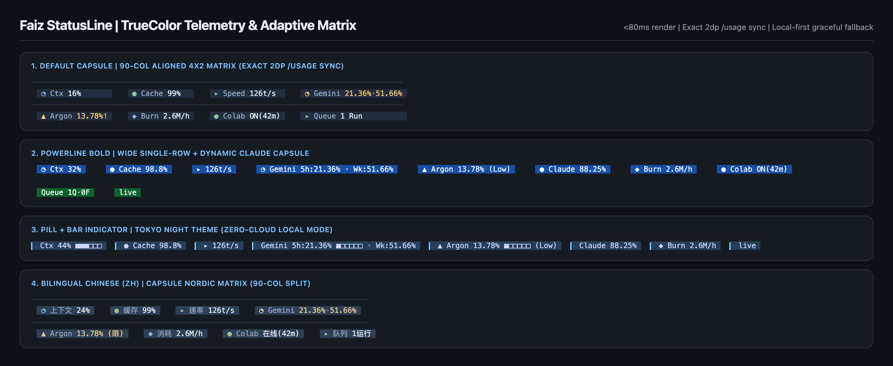
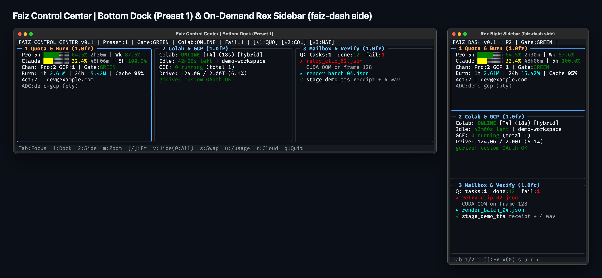
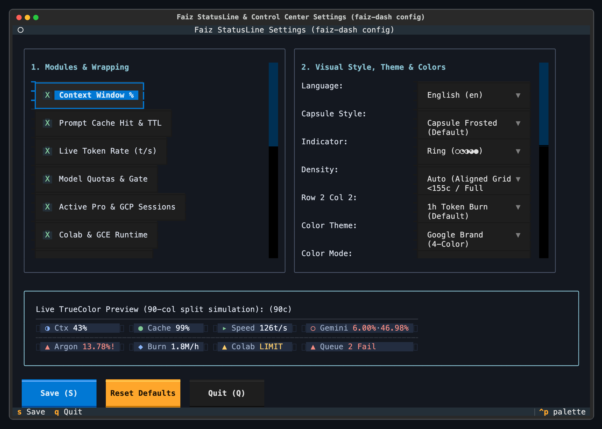
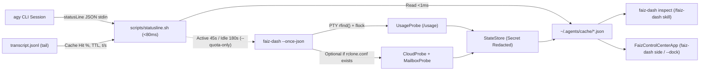

# Faiz Control Center (`faiz-dash`)

[](LICENSE)
[](pyproject.toml)
[](https://textual.textualize.io/)

**Ultra-fast (`<80ms`) TrueColor `statusLine`, exact 2-decimal `/usage` quota sync, zero-clutter in-session diagnostic bubbles (`/faiz-dash`), and an on-demand Textual TUI Control Center built for [Antigravity CLI](https://antigravity.google) (`agy`).**

English | [简体中文](README.zh-CN.md)



---

## Highlights

- **Exact `/usage` Quota Parity (`21.36% · 51.66%`)**: Captures live 5-hour & weekly remaining limits via an isolated PTY `/usage` probe (`flock`-guarded, `rfind()` frame settle to prevent TUI repaint tearing) with **activity-aware 45s refresh** when active turns burn quota (180s when idle).
- **Sub-80ms Pure Bash + `jq` StatusLine**: Never blocks prompt rendering. Features a **90-col 4x2 aligned matrix** on split panes, single-row expansion on wide terminals (`>=155` cols), `Apple_Terminal` 16-color auto-fallback, and zero-noise hiding when no cloud remote is configured.
- **Prompt Cache Hit & Live Token Speed (`t/s`)**: Reads only the trailing tail of the active session `transcript.jsonl` to surface Cache Hit %, 3m/4m TTL cooldown alerts, and real-time output generation speed (`t/s`).
- **Zero-Clutter On-Demand Inspection**:
  - **In-chat Diagnostic Bubble (`/faiz-dash` / `faiz-dash inspect`)**: Outputs a clean Markdown summary of all quota buckets, reset countdowns, 24h per-model token burn, cloud/drive backoff state, mailbox items, and read-only APM telemetry without occupying terminal width.
  - **On-Demand Rex Sidebar (`faiz-dash side`)**: Toggles a 28% vertical Textual sidebar in Rex (`--focus=false`) on demand (`q` or `faiz-dash side` to dismiss). Defaults to no permanent dock (`faiz-dash off`).
- **Bilingual Settings Studio (`faiz-dash config`)**: Interactive `en`/`zh` Textual config editor with 5 visual styles (`capsule`, `powerline`, `pill`, `ghost`, `minimal`), themes (`google`, `nord`, `tokyo_night`, `catppuccin`, `custom`), `ring`/`bar` indicators, quota precision (`exact` / `1dp` / `int`), and live preview.
- **Optional Cloud & Worker Swarm Extension**: Seamlessly monitors Colab runtime heartbeats, 60-minute idle timers, GCE Spot instances, `rclone` Drive quota (with persistent exponential rate-limit backoff), and async mailbox job verification when `rclone.conf` is configured.

---

## TUI Control Center & Settings Studio





---

## Architecture



---

## Quick Start (30 Seconds)

### Prerequisites
- **macOS or Linux** with Python **3.12+**, `bash`, and `jq`
- **Antigravity CLI** (`agy` on `PATH`)
- Optional: **Rex Terminal** (`rex` on `PATH`) for `faiz-dash side` / `dock` split panes; **rclone / gcloud** only if using Colab/GCE cloud monitoring

### Install

#### One-line installer (macOS & Linux)

```bash
curl -fsSL https://faiz-control-center.pages.dev/install.sh | bash
```

*(Cloudflare Pages edge-accelerated mirror; GitHub raw fallback: `https://raw.githubusercontent.com/Jamie-z-Jianmin/faiz-control-center/main/docs/site/install.sh`)*

#### Manual / Developer install

```bash
git clone https://github.com/Jamie-z-Jianmin/faiz-control-center.git
cd faiz-control-center

# 1. Install Python package & Textual UI (use a virtualenv or pipx)
python3 -m pip install -e .

# 2. Link statusline, CLI wrapper, Rex hook, and /faiz-dash skill into ~/.agents & ~/.local/bin
./install.sh --link   # use --copy for standalone copy without symlinks
```

Ensure `~/.local/bin` is in your `PATH`, then add `statusLine` to `~/.gemini/antigravity-cli/settings.json`:

```json
{
  "statusLine": {
    "type": "command",
    "command": "~/.agents/scripts/statusline.sh"
  }
}
```

### Verify

```bash
faiz-dash inspect         # Non-interactive Markdown report from cache
faiz-dash inspect --live  # Run fresh probes and print Markdown report
faiz-dash config          # Open interactive settings TUI with live preview
```

---

## CLI & Hotkey Reference

| Command | Description |
| :--- | :--- |
| `faiz-dash inspect [--live] [--json]` | Print sanitized Markdown (or JSON) snapshot of quotas, burn, cloud/backoff, mailbox, and telemetry |
| `faiz-dash side` | Toggle on-demand right-split Textual sidebar inside Rex (`--focus=false`), or print native Terminal hint |
| `faiz-dash dock` | Toggle on-demand bottom 3-column Dock inside Rex |
| `faiz-dash config` | Launch interactive settings TUI (also accepts CLI flags: `--style`, `--theme`, `--lang`, `--quota-precision`, `--side-ratio`, `--auto-dock on\|off`, `--show`, `--reset`) |
| `faiz-dash off` / `on` / `status` | Disable/enable startup auto-dock (`~/.agents/cache/dash_disabled`) and inspect cache ages |
| `faiz-dash --once-json [--quota-only] [--no-pty]` | Run one-shot probe collection and emit combined JSON |
| `faiz-dash --preset 1 \| 2` | Open full-terminal TUI directly in horizontal Dock (`1`) or vertical Sidebar (`2`) |

### In-TUI Keybindings (`faiz-dash` / `faiz-dash side`)

- `Tab` / `Shift+Tab`: Focus next / previous panel
- `1` / `2`: Switch Horizontal Dock (`1`) / Vertical Sidebar (`2`)
- `m`: Zoom / unzoom focused panel
- `[` / `]`: Adjust panel width/height weight (`-0.1fr` / `+0.1fr`)
- `v` / `0` / `!` `@` `#`: Toggle panel visibility or restore all
- `s`: Swap focused panel position
- `u` / `r`: Force-refresh Usage (`/usage`) or Cloud/Mailbox probes
- `q`: Quit pane

---

## Configuration & Optional Cloud Extension

All settings live cleanly in `~/.agents/statusline_config.json` (zero config needed for local-only mode):

```json
{
  "language": "en",
  "style": "capsule",
  "indicator": "ring",
  "density": "auto",
  "secondary_metric": "burn",
  "theme": "google",
  "color_mode": "row",
  "quota_precision": "exact",
  "control_center": {
    "side_ratio": 28,
    "dock_ratio": 22
  }
}
```

### Enabling Colab / GCE / Drive Monitoring (Optional)

If your workflow runs remote workers on Google Colab + Drive (`rclone`) + GCE Spot:
1. Configure an `rclone` remote (e.g., `gdrive`) in `~/.config/rclone/rclone.conf`.
2. Customize `"cloud"` paths in `~/.agents/statusline_config.json` or via environment variables (`FAIZ_GCP_PROJECT`, `FAIZ_RCLONE_REMOTE`, `FAIZ_COLAB_STATUS_PATH`, `FAIZ_MAILBOX_ROOT`, `FAIZ_PROJECTS_ROOT`).
3. If `rclone.conf` is absent, `CloudProbe` stays safely in `NOT_CONFIGURED` mode and `statusline.sh` hides cloud capsules automatically with zero error noise.

---

## Development & Tests

```bash
PYTHONPATH=src python3 -m unittest discover -s tests -v
```

GitHub Actions CI ([`.github/workflows/ci.yml`](.github/workflows/ci.yml)) verifies shell syntax, `styles.tcss` wheel packaging, and all 36 unit/integration/Textual Pilot tests across Ubuntu & macOS.

## License

[MIT](LICENSE)
