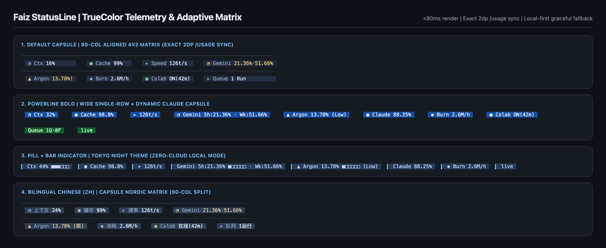
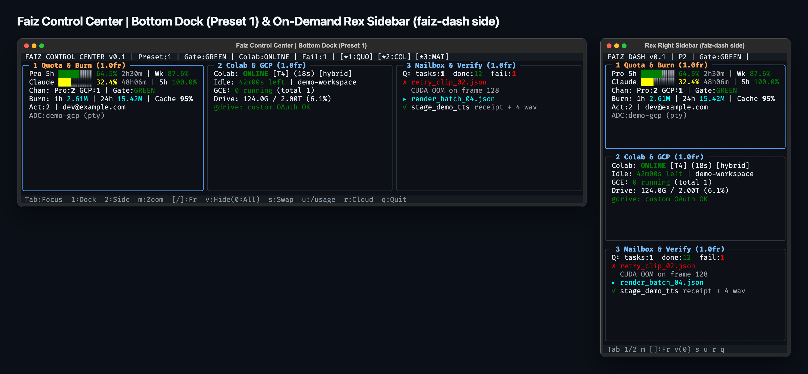
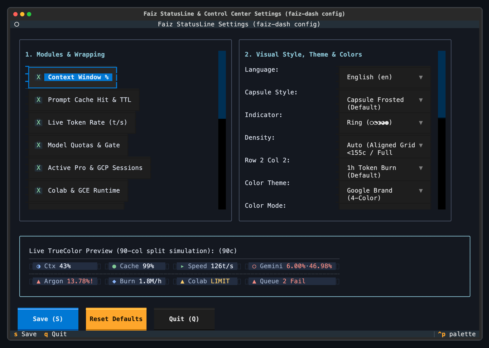
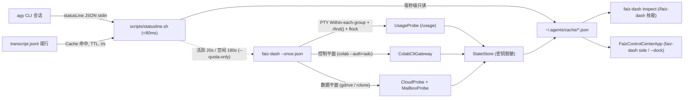

# Faiz Control Center (`faiz-dash`)

[](LICENSE)
[](pyproject.toml)
[](https://textual.textualize.io/)

**专为 [Antigravity CLI](https://antigravity.google) (`agy`) 打造的极速 (`<80ms`) TrueColor 状态栏、两位小数 `/usage` 实时配额同步、无占屏对话气泡诊断 (`/faiz-dash`) 与按需 Textual 控制台。**

[English](README.md) | 简体中文



---

## 核心特性

- **`/usage` 双组实时配额对齐（`GEMINI MODELS` + `CLAUDE AND GPT MODELS`）**：通过隔离 PTY 探针采集 5 小时与每周剩余配额（带 `flock` 并发锁，以及基于 `Within each group` 与 `rfind()` 的动态尾帧收敛，兼顾极速返回与防重绘撕裂）；当检测到活跃对话消耗配额时自动切换为 **20 秒高频后台刷新**（空闲保持 180 秒零消耗）。当无独立 Argon 分组时自动以 `Claude` 胶囊与 TUI 面板行替代呈现，同时向后兼容旧版三分组快照与 `capsule_colors.argon` 配色覆盖。
- **`<80ms` 纯 Bash + `jq` 热路径渲染**：永不阻塞输入提示符。采用统一**深石板蓝**默认视觉与四级自适应矩阵：宽屏（`>=155` 列）自动扩展为完整标签 **`2×4` 铺满矩阵**，中屏分屏（`88–154` 列）保持 **4 行紧凑 `2×4` 玻璃胶囊**（内建 `cold` 标签兜底防塌缩），窄屏分屏（`46–86` 列）自动收紧为 **5 行 `4×2` 石板蓝线框 `[ ... ]` 胶囊**，并支持 `Apple_Terminal` 16 色降级与无云端配置零噪音隐藏。
- **Prompt Cache 命中率与实时输出速率 (`t/s`)**：仅增量读取当前会话 `transcript.jsonl` 尾行，实时呈现缓存命中率、3m/4m TTL 冷却预警与真实输出速度 (`t/s`)。
- **零常驻挤压的双通道检视**：
  - **会话内气泡式诊断（`/faiz-dash` / `faiz-dash inspect`）**：不占用终端列宽，直接输出配额分组与重置倒计时、24 小时各模型 Token Burn、Cloud/Drive 退避与 `colab_source` / `colab_gpu` / `drive_backend` 遥测、Mailbox 队列核验与只读 APM 遥测摘要。
  - **Rex 按需右侧边栏（`faiz-dash side`）**：在 Rex 内一键开关右侧 28% 宽度实时看板（`--focus=false` 不抢焦点，按 `q` 或再次执行 `faiz-dash side` 关闭），默认关闭启动自动 Dock（`faiz-dash off`）。
- **中英双语设置工作室（`faiz-dash config`）**：交互式配置 8 个信息模块、5 种视觉风格（`capsule` / `powerline` / `pill` / `ghost` / `minimal`）、5 套主题配色（`google` / `nord` / `tokyo_night` / `catppuccin` / `custom`）、**按胶囊独立覆盖配色（`capsule_colors` / `--capsule-color`，其中 `argon` 自动向后兼容映射至 `claude`）**、行统一配色（`row_colors`）、`ring`/`bar` 指示器、配额精度（`exact` 2 位 / `1dp` / `int`）、启动开关及 Rex 分屏比例，底部提供实时 TrueColor 预览。
- **双平面云算力与异步队列扩展**：将 `google-colab-cli`（`colab --auth=adc`）控制平面（实时会话、GPU 型号、算力单元余额）与 Drive 数据平面解耦，支持 `gdrive` CLI 与 `rclone` 双后端自动优选（`FAIZ_DRIVE_BACKEND=auto|gdrive|rclone`），并集成 GCE Spot 实例监控、Drive 水位（含持久指数退避）与产物防假完成核验。

---

## TUI 控制中心与设置工作室





---

## 系统架构



---

## 30 秒快速上手

### 环境依赖
- **macOS 或 Linux**，Python **3.12+**、`bash`、`jq`
- **Antigravity CLI**（`agy` 位于 `PATH`）
- 可选：**Rex Terminal**（支持 `faiz-dash side` / `dock` 按需分屏）；仅需监控 Colab/GCE/Drive 时才需要 **`colab` CLI（`google-colab-cli`）、`gdrive` CLI、`rclone` 或 `gcloud`**

### 安装步骤

#### 一行命令自动安装（macOS & Linux）

```bash
curl -fsSL https://faiz-control-center.pages.dev/install.sh | bash
```

*（Cloudflare Pages 全球边缘节点加速；GitHub 备用源：`https://raw.githubusercontent.com/Jamie-z-Jianmin/faiz-control-center/main/docs/site/install.sh`）*

#### 手动 / 开发模式安装

```bash
git clone https://github.com/Jamie-z-Jianmin/faiz-control-center.git
cd faiz-control-center

# 1. 安装 Python 包与 Textual 依赖（建议在虚拟环境或 pipx 中执行）
python3 -m pip install -e .

# 2. 将 statusline、CLI 包装器、Rex Hook 与 /faiz-dash Skill 软链至 ~/.agents 与 ~/.local/bin
./install.sh --link   # 外部用户如需独立拷贝安装可传 --copy
```

确认 `~/.local/bin` 已加入 `PATH`，随后在 `~/.gemini/antigravity-cli/settings.json` 中配置 `statusLine`：

```json
{
  "statusLine": {
    "type": "command",
    "command": "~/.agents/scripts/statusline.sh"
  }
}
```

### 快速验证

```bash
faiz-dash inspect         # 读取缓存毫秒输出 Markdown 诊断报告
faiz-dash inspect --live  # 立即触发最新探针后输出诊断报告
faiz-dash config          # 打开双语实时预览设置中心
```

---

## 常用指令与快捷键

| 指令 | 作用 |
| :--- | :--- |
| `faiz-dash inspect [--live] [--json]` | 非交互式输出配额、24h Burn、云端退避、Mailbox 与 APM 遥测报告 |
| `faiz-dash side` | 在 Rex 中按需打开/关闭右侧边栏（保持主对话焦点；非 Rex 终端会提示替代方案） |
| `faiz-dash dock` | 在 Rex 中按需打开/关闭底部三栏 Dock |
| `faiz-dash config` | 启动设置 UI（也支持 CLI 参数：`--style`、`--indicator`、`--density`、`--secondary`、`--theme`、`--lang zh\|en`、`--quota-precision exact\|1dp\|int`、`--row-colors`、`--capsule-color <id>=<color>`、`--side-ratio`、`--auto-dock on\|off`、`--show`、`--reset`） |
| `faiz-dash off` / `on` / `status` | 关闭/开启新会话自动弹出底部 Dock（`~/.agents/cache/dash_disabled`）及查看缓存状态 |
| `faiz-dash --once-json [--quota-only] [--no-pty]` | 单次采集快照并输出脱敏 JSON |
| `faiz-dash --preset 1 \| 2` | 在当前终端直接以横排 Dock (`1`) 或竖排侧栏 (`2`) 启动全屏 TUI |

### TUI 面板快捷键

- `Tab` / `Shift+Tab`：切换焦点面板
- `1` / `2`：切换横排 Dock / 竖排侧栏视图
- `m`：放大 / 还原当前焦点面板
- `[` / `]`：微调当前面板占比（`-0.1fr` / `+0.1fr`）
- `v` / `0` / `!` `@` `#`：隐藏或恢复面板
- `s`：交换面板顺序；`u` / `r`：手动刷新配额或云端探针；`q`：退出关闭分屏

---

## 配置与可选云端扩展

所有配置保存在 `~/.agents/statusline_config.json`（纯本地模式零配置即可开箱使用）。若你有 Colab / Drive (`gdrive` CLI / `rclone`) / GCE Spot 监控需求：
1. **控制平面（`google-colab-cli`）**：完成 `colab --auth=adc` 授权（存在 ADC 或 `~/.config/colab-cli`）后，即可独立于 Drive 限流实时采集活跃会话数、GPU 型号（`colab_gpu`）、算力单元余额及来源标记 `colab_source`（`colab_cli` 或 `drive` 回退）。
2. **数据平面（`gdrive` CLI / `rclone`）**：配置 `gdrive` CLI（`FAIZ_DRIVE_BACKEND=auto` 下自动优先）或在 `~/.config/rclone/rclone.conf` 中配置目标 remote（默认 `gdrive`），并在遥测中透出当前生效的 `drive_backend`（`gdrive` 或 `rclone`）。
3. 通过 `~/.agents/statusline_config.json` 的 `"cloud"` 字段或环境变量（`FAIZ_GCP_PROJECT`、`FAIZ_DRIVE_BACKEND=auto|gdrive|rclone`、`FAIZ_RCLONE_REMOTE`、`FAIZ_COLAB_STATUS_PATH`、`FAIZ_MAILBOX_ROOT`、`FAIZ_PROJECTS_ROOT`）覆盖路径与后端；未配置 `colab` CLI、`gdrive` CLI 与 `rclone.conf` 时系统保持 `NOT_CONFIGURED` 零告警降级。

---

## 测试与开源协议

```bash
PYTHONPATH=src python3 -m unittest discover -s tests -v
```

[GitHub Actions CI](.github/workflows/ci.yml) 在 Ubuntu 与 macOS 上自动校验 Shell 语法、`styles.tcss` 打包完整性以及全部 47 项单元与 Textual Pilot 集成测试。采用 [MIT License](LICENSE) 开源。
